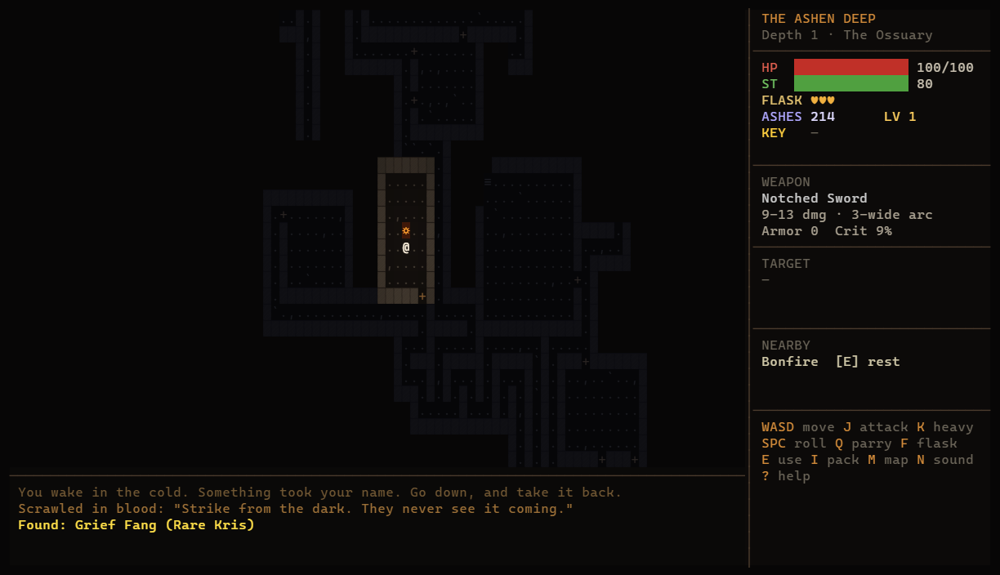
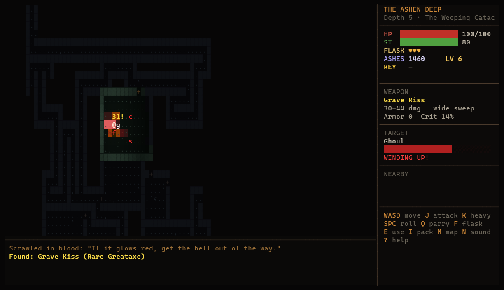
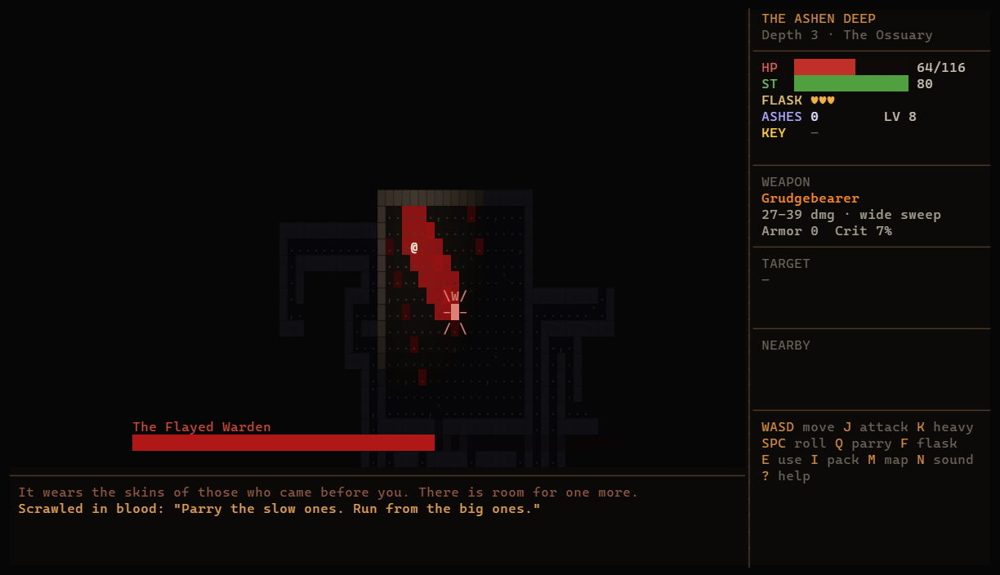
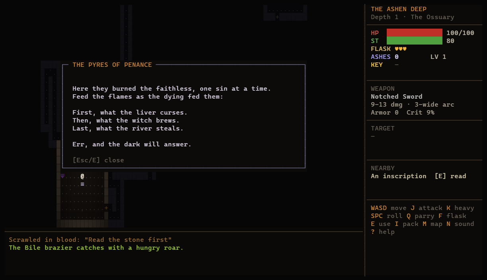
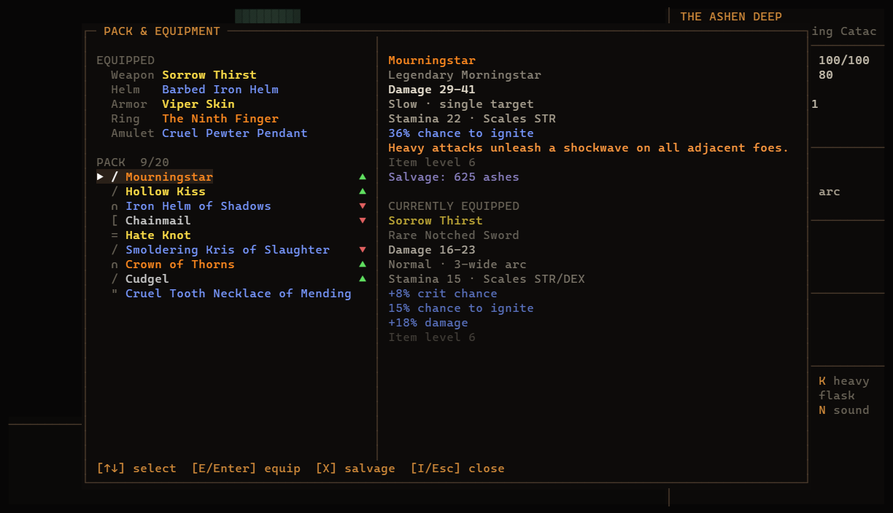

# The Ashen Deep

A dark-fantasy action RPG that runs entirely in your terminal. The combat is real-time and
souls-like, the dungeons are Zelda-style puzzle mazes, and the loot is Diablo-style. It is
written in TypeScript with **zero runtime dependencies**. Even the music and sound effects are
synthesized in code.


## Screenshots

| | |
|---|---|
|  |  |
| **Exploring.** Each floor is a freshly generated maze. Your torchlight is short, and areas you've seen stay on the map, dimmed. | **Combat.** Red tiles are incoming attacks. Step out, roll through, or parry. Gold-named elites hit harder and drop better loot. |
|  |  |
| **Boss fights.** The Flayed Warden telegraphs a cleave across half the arena. A fog gate seals you in. | **Puzzles.** Light the braziers in the order the riddle describes. Get it wrong and something answers. |
|  | |
| **Loot.** Common, Magic, Rare and Legendary items with rolled bonus stats, comparison arrows, and salvaging into ashes. | |

> The screenshots come from the game's own frame buffer. `npm run screenshots` stages each scene through the game API and renders it with headless Chrome.

## Play

Requires **Node 23.6+**, which runs TypeScript directly, so there is no build step. You also need a truecolor terminal. Windows Terminal works great, and 120×34 or larger is ideal.

```bash
git clone https://github.com/mpphelps/ashen-deep.git
cd ashen-deep
npm start
```

| Key | Action |
|---|---|
| `WASD` / arrows | Move. Walk into things to open, push or attack. |
| `J` / `X` | Attack |
| `K` / `C` | Heavy attack: slow, staggers enemies, breaks cracked walls |
| `Space` | Roll (you can't be hit mid-roll) |
| `Q` / `L` | Parry. Time it as the red tile flashes, then riposte for 3× damage. |
| `F` | Drink a flask |
| `E` | Use: bonfires, chests, braziers, inscriptions |
| `I` | Pack & equipment (`E` equip, `X` salvage) |
| `M` | Floor map |
| `N` | Audio: music + sound → sound only → muted |
| `?` | Help |

## What's inside

**Combat (souls-like)**
- Every enemy attack is telegraphed: the tiles it will hit glow red, then strike.
- Stamina limits every swing and roll. Running out leaves you open.
- Parrying staggers an enemy and opens it to a riposte. Unaware enemies take 2.5× backstab damage, and they notice you far faster when they're facing you.
- Enemies include archers, fire-casting cultists, lunging ghouls, exploding bloated corpses, wraiths that walk through walls, and shielded Crypt Knights you have to flank.

**Dungeons & puzzles (Zelda-like)**
- Floors use a "rooms and mazes" generator with a locked exit, a secret room behind a cracked wall, traps, and messages scrawled by the dead.
- You win the key to the exit by solving one of three puzzle types:
  - **Scales of the Dead:** sokoban. Stones are pulled backwards off their plates during generation, so every puzzle is solvable by construction.
  - **Waking Stones:** a lights-out rune grid.
  - **Pyres of Penance:** light the braziers in the order a riddle gives.

**Loot (Diablo-like)**
- Item rarity runs Common, Magic, Rare and Legendary. Items roll bonus stats like life steal, bleed, ignite, crit and thorns.
- There are 10 unique legendaries with special effects, such as *Grudgebearer*, *Mourningstar* and *Crown of Thorns*.
- Loot tables are set per enemy type, chest and urn. Elites carry modifiers like Frenzied, Vampiric, Molten and Vengeful.

**Bosses**
- A boss guards every third depth: the **Flayed Warden**, the **Mother of Maggots** and the **Hollow King**.
- Each has two phases and its own attack patterns.
- After depth 9 the descent continues in New Game+.

**Souls rules**
- Dying drops your ashes as a bloodstain where you fell. Reach it to reclaim them.
- Resting at a bonfire heals you, refills your flasks and lets you level up. It also raises the dead again.
- Progress saves at bonfires and on each new floor to `~/.ashen-deep-save.json`.

**Audio**
- All sound is procedurally synthesized in [`src/audio/`](src/audio):
  - five music loops: title, one per act, and boss fights
  - about 45 effects, including an audible tell when enemies wind up
- The first launch renders a WAV cache to `~/.ashen-deep/audio/`.
- Playback uses winmm/MCI on Windows (through a background PowerShell helper), `afplay` on macOS, and `paplay` or `aplay` on Linux.
- `--mute` starts silent and `--no-audio` turns audio off entirely.

## Development

```bash
npm test             # floor generation checks, bot fuzzing, scripted mechanics, audio checks
npm run typecheck    # tsc --noEmit
npm run screenshots  # regenerate docs/screenshots
```

| File | Purpose |
|---|---|
| `src/dungeon.ts` | floor generation, lock & key, puzzles, sokoban solver |
| `src/game.ts` | simulation at 20 ticks/s: combat, interaction, saves |
| `src/ai.ts` | enemy behaviours and boss attack patterns |
| `src/loot.ts` | items, affixes, uniques, loot tables, stats |
| `src/render.ts` | lighting, HUD, menus, title screen |
| `src/term.ts` | diffed truecolor screen buffer |
| `src/audio/` | synthesizer, sound design, platform playback |

Balance numbers live in `src/data.ts` (bestiary, bosses) and `src/loot.ts` (drops, items).
