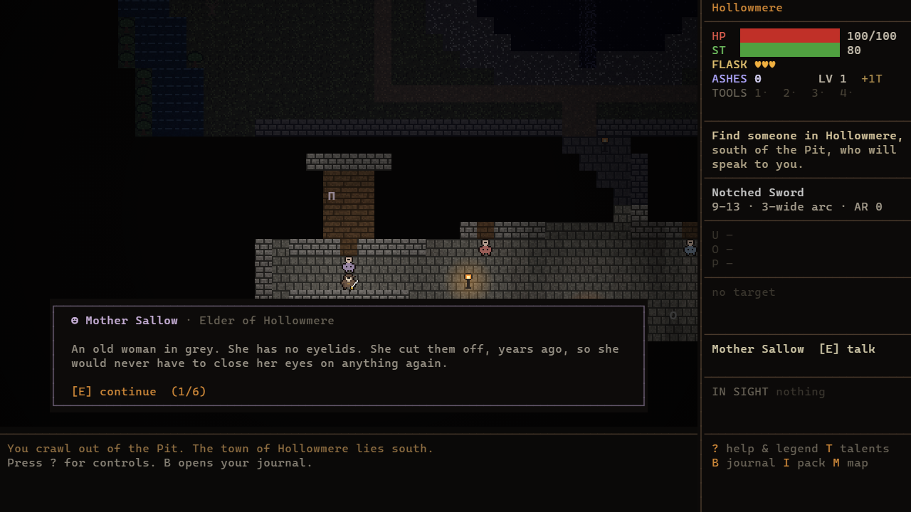
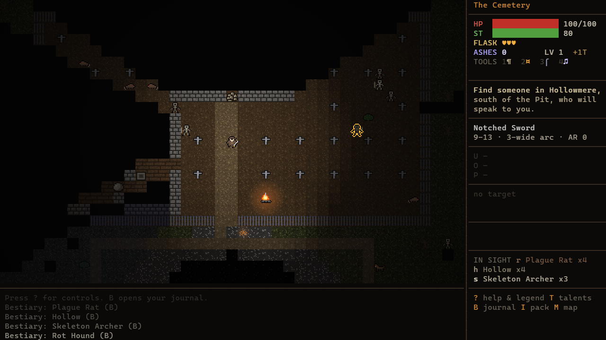
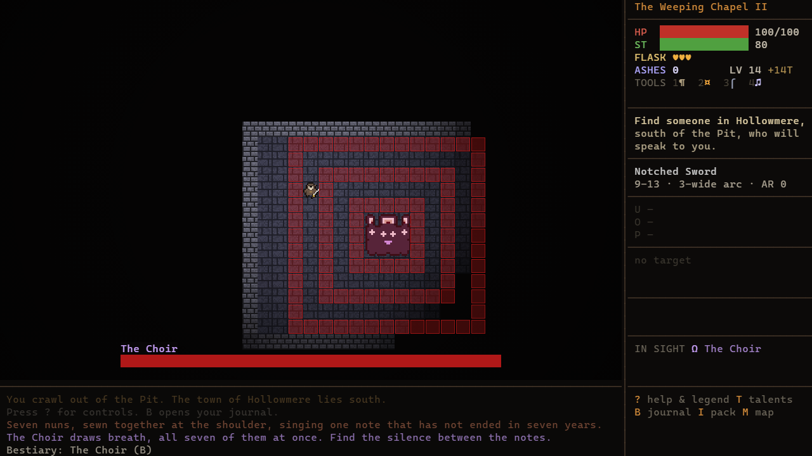
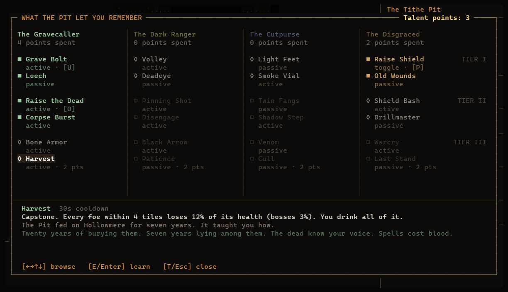

# The Ashen Deep

[](https://mpphelps.github.io/ashen-deep/)

A dark-fantasy action RPG you can play **in your terminal or in your browser**. It has an open world
to explore, four dungeons, a hub town full of people who hate you, and a story you piece together
from what the dead leave behind. The combat is real-time and souls-like, the world and dungeons are
Zelda-style puzzles, and the loot is Diablo-style. It is written in TypeScript with
**zero runtime dependencies**. The music, the sound effects and even the pixel art are generated in code.

> Content warning: this is a very dark game. It deals with grief, the death of a child,
> cannibalism, self-harm and religious horror.


## Two ways to play

**[▶ Play it now in your browser](https://mpphelps.github.io/ashen-deep/)** (no install needed)

One game core, two renderers. Everything works the same in both: every quest, boss, puzzle, talent and save system.

| In the terminal: `npm start` | In the browser: `npm run web` |
|---|---|
|  |  |
|  |  |
|  |  |
| Every creature, wall and item is a colored character, lit by your torch. Runs in any truecolor terminal. | The same world in pixel-art sprites drawn in code. Characters glide between tiles, attacks and wind-ups are animated, light and flame glow through the dark, and held keys move smoothly. |

## The story, without spoilers

You climb out of the Tithe Pit outside **Hollowmere**, a town that has not seen the sun in seven
years. Seven years ago they threw you in. Everyone remembers why except you. They call you
*Digger*, and they would very much like you to go back down.

The truth comes out a piece at a time: in what NPCs will and won't say, in items found in the
dark, in what the bosses scream as they die.

## More screenshots (terminal)

| | |
|---|---|
|  |  |
| **Hollowmere.** The hub town: eight broken, eccentric survivors, and vendors and quest givers who mostly loathe you. | **The open world.** The cemetery, its graves (you can dig them up), and the rubble choking the Ossuary. A named child walks among the dead. |
|  |  |
| **Themed dungeons.** Each biome has its own rooms: here, the Rotwood's Hanging Grove. Red tiles are incoming attacks. | **Bosses.** The Choir sings rings of death. Find the silence between the notes. |
|  |  |
| **The journal.** Quests, lore pages and keepsakes. The story lives here. | **The Pale.** The Rotwood, the river, the cemetery, the Pit, the town, the gorge and the chapel heights. |
|  | |
| **Talents.** Four half-remembered lives. One point per level, capstones cost two; you will master about two paths per playthrough. | |

> The screenshots come from the game's own frame buffer. `npm run screenshots` stages each scene through the game API and renders it with headless Chrome.

## Play

Requires **Node 23.6+**, which runs TypeScript directly. For the terminal version you need a truecolor terminal: Windows Terminal works great, and 120×34 or larger is ideal. For the browser version, any modern browser works (tested in Chrome).

```bash
git clone https://github.com/mpphelps/ashen-deep.git
cd ashen-deep
npm install          # dev tools only: the TypeScript checker and the browser bundler
npm start            # play in the terminal
npm run web          # play in the browser (builds, serves on localhost:8187, and opens it)
```

Saves are separate: the terminal version saves to `~/.ashen-deep-save.json`, and the browser version saves in the browser's local storage.

| Key | Action |
|---|---|
| `WASD` / arrows | Move. Walk into people and things to talk, open, push or attack. |
| `J` / `X` | Attack |
| `K` / `C` | Heavy attack: slow, staggers enemies, breaks cracked walls |
| `Space` | Roll (you can't be hit mid-roll) |
| `Q` / `L` | Parry. Time it as the red tile flashes, then riposte for 3× damage. |
| `F` | Drink a flask |
| `E` | Use / talk: bonfires, chests, inscriptions, people |
| `R` | Use your tool · `1`–`4` choose which |
| `U` `O` `P` | Use the active talents bound to those slots |
| `T` | Talents: learn with `E`, bind actives with `1`–`3` |
| `I` | Pack & equipment (`E` equip, `X` salvage) |
| `B` | Journal: quests, lore, keepsakes |
| `M` | Map |
| `N` | Audio: music + sound → sound only → muted |
| `?` | Help |

## What's inside

**An open world that is itself a puzzle (metroidvania-style)**
- One hand-designed overworld: the town, the Pit, a cemetery, a river, a rotting forest, a gorge and the chapel heights.
- It has roaming enemies, bonfires you can travel between, overworld puzzles, and secrets that only open up once you have the right tool.
- The four regions open in order, through the world itself rather than walls:
  - You need your old spade to dig into the Ossuary.
  - A broken bridge waits on a quest, and thorns must be burned.
  - A gorge has to be crossed with a chain hook.
  - A stair into the Pit only exists while a bell is ringing.

**Tools**

| Tool | What it does |
|---|---|
| Gravedigger's Spade | digs rubble and graves (some graves are not empty) |
| Warden's Lantern | widens your light; throws flame that burns thorns, lights braziers from a distance and sets enemies on fire |
| Chain Hook | bites across gaps of up to 7 tiles; drags enemies to you; pulls puzzle stones toward you (new sokoban moves) |
| Silent Bell | makes phantom bridges solid for a while; staggers wraiths |

**Four dungeons, four biomes**
- Each is two procedurally generated floors with its own walls, enemies and themed rooms (the Small Ossuary, the Larder, the Scriptorium, the Kneeling Hall, and more), each described as you enter.
- Zelda-style structure: the first floor's puzzle gives you the dungeon's tool, and the second floor locks its key behind an obstacle only that tool can clear.
- Quest items and lore are placed in rooms whose theme fits them.

| Dungeon | Biome | Boss |
|---|---|---|
| The Ossuary | crypt | The Flayed Warden |
| The Rotwood Hollow | rot forest | Mother of Maggots |
| The Weeping Chapel | church | The Choir |
| The Throne Below | abyss | The Hollow King |

**Hollowmere**
- Eight NPCs, each warped by surviving: an elder with no eyelids, a cheerful butcher who sells meat nobody asks about, a blind tinker who keeps his dead wife in the shop, a woman who cut off her own fingers, a mute girl who draws, a flagellant monk, a drunk captain, and the half-melted keeper of the town's fire.
- Most of them despise you. Some warm up after you finish their quests.
- There are seven quests, two vendors, quest-only legendary rewards, and two endings.

**Talent paths**
- You start knowing nothing. Each level-up gives 1 talent point. You can mix paths freely, but tier II needs 2 points spent in that path, tier III needs 4, and capstones cost 2.
- A full playthrough masters about two paths. Forgetting everything at a bonfire costs ashes.
- Each path pays for its skills differently:

| Path | Fantasy | Pays with | Highlights |
|---|---|---|---|
| The Gravecaller | necromancy | your own blood | Grave Bolt, Raise the Dead (thralls from corpses), Corpse Burst, Bone Armor, Harvest |
| The Dark Ranger | bows | stamina | Volley, Pinning Shot, Disengage, Black Arrow (piercing), Patience (rewards distance) |
| The Cutpurse | stealth, daggers | stamina | Smoke Vial and Shadow Step set up backstabs, Twin Fangs, Venom, Cull (executes) |
| The Disgraced | shield and sword | stamina | Raise Shield (block stance), Shield Bash, Drillmaster (parries), Warcry, Last Stand |

**Combat (souls-like)**
- Every attack is telegraphed: you can step out, roll through it, or parry it and riposte. Stamina limits everything.
- Sneak up for backstabs. Shielded knights have to be flanked.
- There are 13 enemy types, plus named elites with Diablo-style modifiers.

**Puzzles**
- Sokoban scales (verified solvable by construction), lights-out rune grids, and braziers lit in the order a riddle gives.
- They appear in dungeons and out in the world.

**Loot (Diablo-like)**
- Item rarity runs Common, Magic, Rare and Legendary, with rolled bonus stats.
- There are 14 unique items, four of them earned only from quests.
- Loot tables are set per enemy, chest and urn.

**Souls rules**
- Dying drops your ashes as a bloodstain where you fell.
- Bonfires heal you, level you up and let you travel, but resting raises the dead again.

**Audio**
- Twelve procedurally synthesized music loops, so every region, the town and each dungeon has its own: a broken music box in the town square, a funeral organ in the cemetery, a heartbeat in the Pit, a dead choir on the chapel heights.
- Every track is aged like a dying recording: tape wow and flutter, hiss, crackle and a muffled top end.
- About 50 sound effects.
- Playback uses winmm on Windows, `afplay` on macOS, and `paplay` or `aplay` on Linux.
- `--mute` starts silent and `--no-audio` turns audio off entirely.

Progress saves at bonfires and doorways to `~/.ashen-deep-save.json`.

## Development

```bash
npm test             # world gates, dungeon gating, puzzle solvability, bot playthroughs, story path, audio
npm run typecheck    # tsc --noEmit
npm run screenshots  # regenerate docs/screenshots
npm run build:web    # build the browser version into web/
node tools/sprite-sheet.ts   # render every sprite to docs/sprite-sheet.png
```

The test suite checks:
- The world's progression gates hold: no region can be reached early with the tools you'd have at that point.
- Every dungeon key needs exactly the right tool.
- Bots play from the start through all four bosses to the ending.
- A scripted run follows the whole story path through the real game API.

| File | Purpose |
|---|---|
| `src/story.ts` | dungeons, quests, lore, NPCs and their dialogue, endings |
| `src/world.ts` | the overworld map and its gates |
| `src/dungeon.ts` | dungeon generation, tool gates, themed rooms, puzzles, sokoban solver |
| `src/game.ts` | simulation at 20 ticks/s: locations, combat, tools, quests, shops, saves |
| `src/talents.ts` / `src/skills.ts` | talent paths and data / active skills, thralls, talent screen |
| `src/ai.ts` | enemy behaviours and boss attack patterns |
| `src/data.ts` | bestiary, bosses, biomes, room themes |
| `src/loot.ts` | items, affixes, uniques, loot tables, stats |
| `src/render.ts` | lighting, HUD, dialogue, menus |
| `src/audio/` | synthesizer, sound design, platform playback |
| `src/web/` | browser version: sprite art (`art.ts`), sprite renderer, Web Audio, entry point |
| `src/platform.ts` | the seam between the game and the outside world (saves) |
